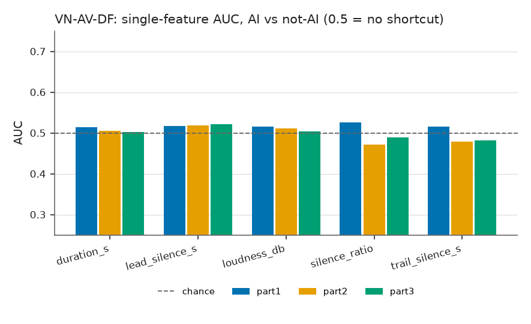

# VN-AV-DF leakage audit

Rows: 23242 (parts: vn-av-df-data-part1, vn-av-df-data-part2, vn-av-df-data-part3). Speakers per split: train 72, validation 17, test 31.

## Overlap between splits

| Key | Distinct values | Shared across splits | By split pair |
|---|---|---|---|
| speaker_id | 120 | 0 | - |
| source_id | 164 | 0 | - |
| source_clip_id | 2400 | 0 | - |
| sha256 | 23242 | 0 | - |
| audio_source_id | 164 | 0 | - |

Borrowed-audio clips (sham / donor / AI voice reference from another video): 1734; crossing splits: 0.

Transcripts: 2400 distinct, shared across splits: 0.

## Test reuse

Logged test uses: 16 in rounds v005_results, v006_results (2 sessions); trained checkpoints: 14, tested more than once: 0 (training-free SpeechForensics excluded: it has no weights). Rounds without a test-log.json (the log starts in v005) are not counted, and the log cannot show design decisions taken after looking at test numbers; the external datasets of report.md are the answer to that.

| Round | Checkpoint | Session | Time | Use |
|---|---|---|---|---|
| v005_results | avh_align_plus_seed42 | train-test-20261111-0910 | 2026-11-11 09:28:03 | 1 |
| v005_results | avh_align_seed42 | train-test-20261111-0910 | 2026-11-11 09:33:42 | 1 |
| v005_results | avh_align_sup_seed42 | train-test-20261111-0910 | 2026-11-11 09:39:27 | 1 |
| v005_results | lipinc_v2_seed42 | train-test-20261111-0910 | 2026-11-11 09:45:17 | 1 |
| v005_results | speechforensics_seed42 | train-test-20261111-0910 | 2026-11-11 09:51:01 | 1 |
| v005_results | trihead_v5_no_pair_seed42 | train-test-20261111-0910 | 2026-11-11 10:10:08 | 1 |
| v005_results | trihead_v5_seed42 | train-test-20261111-0910 | 2026-11-11 10:28:52 | 1 |
| v005_results | xlsr_frozen_seed42 | train-test-20261111-0910 | 2026-11-11 10:35:48 | 1 |
| v006_results | avh_align_plus_seed43 | train-test-20261114-0458 | 2026-11-14 05:16:38 | 1 |
| v006_results | avh_align_seed43 | train-test-20261114-0458 | 2026-11-14 05:22:50 | 1 |
| v006_results | avh_align_sup_seed43 | train-test-20261114-0458 | 2026-11-14 05:29:01 | 1 |
| v006_results | lipinc_v2_seed43 | train-test-20261114-0458 | 2026-11-14 05:34:10 | 1 |
| v006_results | speechforensics_seed43 | train-test-20261114-0458 | 2026-11-14 05:40:26 | 1 |
| v006_results | trihead_v5_no_pair_seed43 | train-test-20261114-0458 | 2026-11-14 06:00:46 | 1 |
| v006_results | trihead_v5_seed43 | train-test-20261114-0458 | 2026-11-14 06:20:48 | 1 |
| v006_results | xlsr_frozen_seed43 | train-test-20261114-0458 | 2026-11-14 06:28:24 | 1 |

## Single-feature shortcuts

| Part | Feature | AUC (all) | Most extreme cell | AUC (cell vs real) |
|---|---|---|---|---|
| vn-av-df-data-part1 | duration_s | 0.514 | source/full | 0.525 |
| vn-av-df-data-part1 | lead_silence_s | 0.518 | voice/full | 0.628 |
| vn-av-df-data-part1 | loudness_db | 0.515 | voice/full | 0.536 |
| vn-av-df-data-part1 | silence_ratio | 0.525 | voice/full | 0.675 |
| vn-av-df-data-part1 | trail_silence_s | 0.516 | voice/full | 0.576 |
| vn-av-df-data-part2 | duration_s | 0.506 | source/full | 0.512 |
| vn-av-df-data-part2 | lead_silence_s | 0.519 | voice/full | 0.685 |
| vn-av-df-data-part2 | loudness_db | 0.511 | voice/full | 0.569 |
| vn-av-df-data-part2 | silence_ratio | 0.472 | voice/partial | 0.439 |
| vn-av-df-data-part2 | trail_silence_s | 0.479 | voice/full | 0.390 |
| vn-av-df-data-part3 | duration_s | 0.502 | donor/full | 0.509 |
| vn-av-df-data-part3 | lead_silence_s | 0.522 | voice/full | 0.684 |
| vn-av-df-data-part3 | loudness_db | 0.504 | voice/full | 0.575 |
| vn-av-df-data-part3 | silence_ratio | 0.489 | donor/full | 0.539 |
| vn-av-df-data-part3 | trail_silence_s | 0.482 | voice/full | 0.339 |

Duration AUC per split (manifest): train 0.505, validation 0.505, test 0.505.

